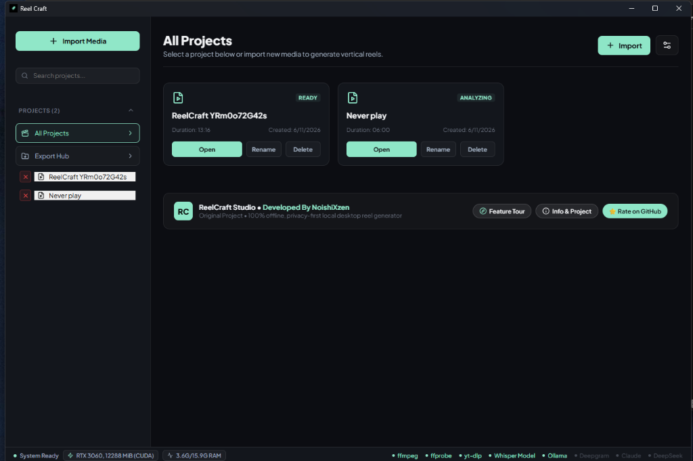
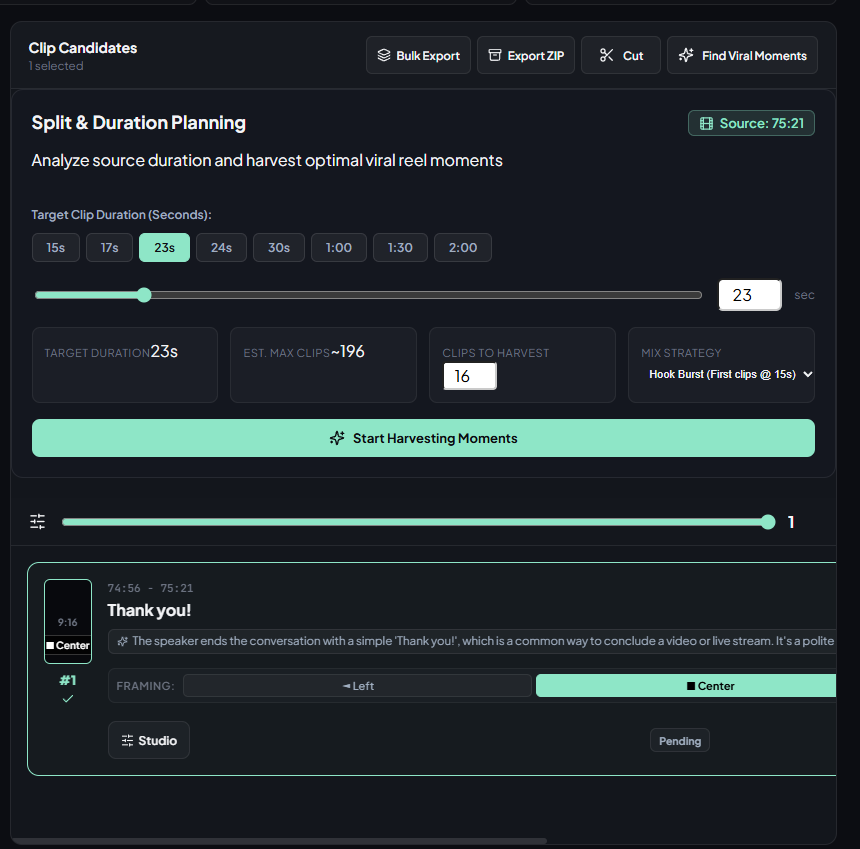
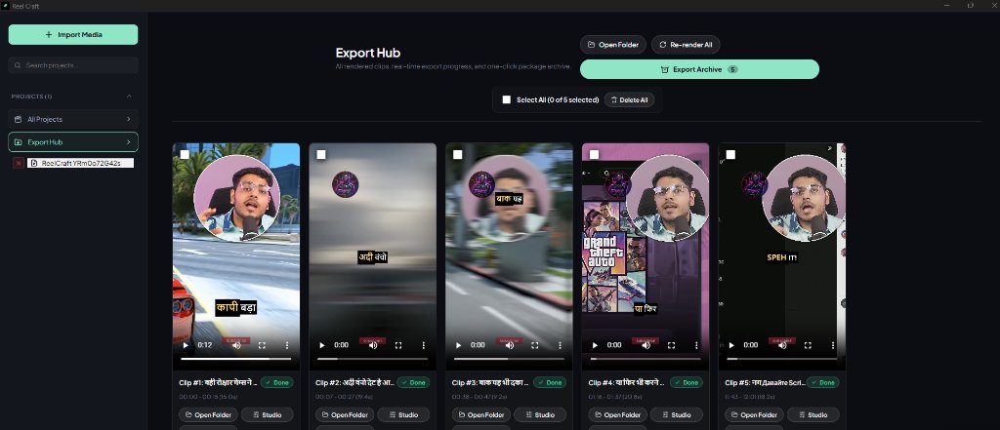

# Reel Craft

**AI Long-Form to Vertical 9:16 Short-Form Video Studio for Windows (64-bit).**

Convert podcasts, interviews, gameplay recordings, YouTube videos, and stream VoDs into vertical 9:16 Reels, Shorts, and TikToks with local GPU/CPU Whisper transcription (including multi-language & Bengali hybrid transcription), AI viral moment harvesting, active captions, and hardware-accelerated NVENC/QSV/AMF export.

---

## Download & Installation (Windows 64-bit)

Download the latest signed Windows installer from [**Releases (Latest)**](https://github.com/pushpajit-dev/reelcraft/releases/latest):

- **`Reel.Craft_0.2.4_x64-setup.exe`** — NSIS Windows Setup Wizard (recommended)
- **`Reel.Craft_0.2.4_x64_en-US.msi`** — Windows MSI Installer

### Installation Steps
1. Download **`Reel.Craft_0.2.4_x64-setup.exe`** (or the `.msi` package) from the latest GitHub Release.
2. *(Optional, for signed publisher trust)* If Windows prompts about our self-signed publisher certificate, download `AivoryStudios.cer` and run `Install-Aivory-Certificate.bat` as Administrator from the release assets (or `msi/` / `nsis/`).
3. Run the installer and launch **Reel Craft** from the Start Menu or Desktop shortcut.
4. On first launch inside the app, Reel Craft auto-detects `FFmpeg`, `ffprobe`, `yt-dlp`, Python/Whisper, and Ollama (or lets you install/configure models directly from **Settings**).

---

## License Activation (1 Year Free & Gumroad)

Reel Craft uses an online-only, single-device (1 Windows PC HWID) activation flow linked directly to **Aivory Portal** and **Gumroad**:

### Option A: Get a 1-Year Free License (Aivory Portal)
1. Visit the **Aivory Portal** site: [**https://aivoryportal.vercel.app**](https://aivoryportal.vercel.app) *(Activation API: `https://aivoryportal.vercel.app/api`)*.
2. Register or sign in to your Aivory Portal account and claim your **1-Year Free Reel Craft License**.
3. Open **Reel Craft**, enter your **registered Aivory Portal email** and **license code** in the activation screen, and click **Activate**.

### Option B: Purchase on Gumroad (Direct Gumroad Activation)
1. Purchase a license directly on Gumroad: [**https://pushpajit.gumroad.com/l/zabnjf**](https://pushpajit.gumroad.com/l/zabnjf).
2. Copy the Gumroad license key sent to your receipt email.
3. Open **Reel Craft**, enter your **Gumroad checkout email** and **Gumroad license key**, and click **Activate** — verified directly with Gumroad and bound to your PC.

> **Device & Network Policy:** Each license is bound to **1 Windows PC** (`HWID`) and requires an active internet connection on startup for online verification.

---

## Screenshots

### Clip Candidates & Moment Harvesting
Split long videos (`15s`–`2:00`), pick framing modes, and harvest viral moments locally or with cloud LLMs:

### Export Hub
Review rendered vertical 9:16 reels with custom captions, overlays, and one-click folder or `.zip` export:

---

## Core Capabilities

- **PC-Wide Auto-Detection** — Automatically finds GPU (`CUDA`), CPU threads, `FFmpeg`, `yt-dlp`, Python Whisper environments, and local `Ollama` models.
- **Hybrid Transcription & Multi-Language Captions** — Offline OpenAI Whisper (`tiny` to `large-v3`) and Google Gemini Cloud transcription (with auto language detection across 85+ languages & vocal-envelope Bengali/Indic sync), active word highlight, custom fonts, strokes, and shadows.
- **Clip Studio & Framing** — Left/Center/Right crop presets, webcam PiP & split layouts, channel subscribe/like badges, vignette, logos, background blur, and hardware encoding (`NVENC` / `QSV` / `AMF`).
- **Bulk Export Hub** — Queue renders, inspect every rendered MP4 in-app, re-render selected clips, or bundle everything into a ZIP archive.
- **Built-in Aivory Portal Updates, Invoices & Help Feedback** — Top-right header notifications (with unread audio bell chime & Windows taskbar red badge) and invoices when a project is open, plus simple Help & Feedback queries/screenshots synced directly with Aivory Portal & Admin Aivory.

---

## System Requirements

- **OS:** Windows 10 / Windows 11 (64-bit)
- **RAM:** 8 GB minimum (16 GB recommended)
- **GPU (Optional):** NVIDIA CUDA GPU recommended for fast Whisper & NVENC encoding
- **Network:** Active internet connection required for online license activation/verification
